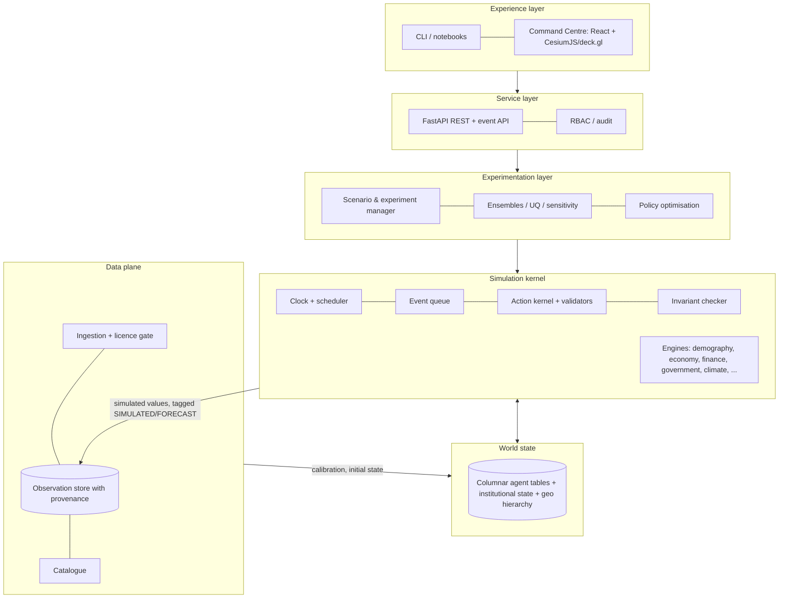

# 03 · WORLD-OS System Architecture Specification (Task 3)

**Status:** v0.1 · Alpha implements the *kernel* layer and a subset of engines in-process; the
distributed layers are specified here and scheduled in docs/09.

## 1. Objectives

* One authoritative, versioned **world state** per simulation branch.
* Many **engines** (transition functions) on a shared clock, with explicit coupling contracts.
* **Agents propose, services dispose**: every state change passes through a validated service.
* A **data plane** that keeps observation and simulation separate, with provenance.
* A path from one process (Alpha) to a partitioned cluster (Stage 3+) **without changing engine code**.

## 2. Layered architecture

## 3. Core contracts (implemented in Alpha)

| Contract | Module | Rule |
|---|---|---|
| `World` | `worldos/core/world.py` | Holds **all** mutable state. `clone()` yields a complete, resumable branch. |
| `Engine` | `worldos/core/engine.py` | Stateless; declares `name`, `order`, `period_months`, `phase`; `step(world)`. |
| `SimulationClock`, `EventScheduler` | `worldos/core/clock.py` | Monthly base tick; events carry data (no code) so state stays serialisable. |
| `RandomStreams` | `worldos/core/rng.py` | One named stream per engine: adding an engine never changes another's draws. |
| `ActionKernel` | `worldos/core/actions.py` | Typed `Action`s from agents/experimenters; per-kind validators and allowed actors; append-only audit log. |
| Ledger services | `worldos/economy/ledger.py` | The *only* code allowed to change financial stocks; every function is double-sided. |
| Invariants | `worldos/validation/invariants.py` | Checked after every tick; strict mode raises `InvariantViolation`. |
| `Provenance` | `worldos/core/provenance.py` | Kind, source, unit, licence, date, resolution, uncertainty, lineage. |

## 4. Time synchronisation (Time Synchronization Specification, summary)

* **Base tick:** one calendar month (Alpha). Engines run when `(tick − phase) mod period = 0`,
  in ascending `order`. Quarterly central-bank decisions run in the third month of the quarter;
  annual fiscal decisions in December.
* **Within-tick protocol** (economy): plan → credit → labour → produce → income → goods → finance →
  expectations → institutions → metrics → invariant check → clock advance. The order is part of the
  model and is documented (docs/06).
* **Faster processes** (hourly energy dispatch, daily weather, intraday markets) will run as
  engine-internal sub-steps and exchange *monthly aggregates* with the kernel; slower processes
  (demographic transitions with annual rates) are converted to monthly hazards.
* **Information lags:** agents observe *published* indicators from the previous tick, never the
  live state (implemented for strategic agents).
* **Consistency between engines:** single-writer rule per state component (e.g. only the labour
  engine changes employment status, except death/retirement in demography; only ledger services
  change money); invariant checks after every tick.
* **Distributed version:** conservative synchronous time-stepping (bulk-synchronous parallel) with
  a barrier per tick; cross-partition interactions (migration, trade, commuting) are exchanged as
  message batches at the barrier.

## 5. State storage (World State Database Design, summary)

* **Hot state** (during a run): struct-of-arrays NumPy tables (`ColumnTable`) per entity type; rows
  are never deleted within a run (stable indices), `alive` flags retire rows.
* **Snapshots:** world clones in memory (Alpha); planned: Arrow/Parquet per table + JSON for
  institutional state, content-addressed and versioned (Iceberg tables for long-term storage).
* **Results:** metrics time series (Parquet/CSV), audit log (JSON lines), run manifest (config,
  seed, code version).
* **Observations:** `ObservationStore` keyed by (entity, variable, time, source) — planned
  backing: PostgreSQL/PostGIS for metadata and vector geometry; Zarr/NetCDF for gridded fields.

## 6. Distributed computing architecture (planned; Stage 3+)

* **Partitioning:** by geography (country → region → H3 cell blocks); each partition owns its agent
  tables. Firms with multi-region operations are owned by their HQ partition and interact via
  messages.
* **Execution:** Ray actors (one per partition) driven by a coordinator implementing the tick
  barrier; vectorised rules inside partitions (NumPy now; JAX/Numba/C++ kernels for hot paths when
  profiling justifies it).
* **Ensembles:** embarrassingly parallel across seeds and arms (Alpha experiments already structure
  work this way).
* **Adaptive resolution:** regions of interest simulated with explicit records (weight 1); the rest
  with weighted records or cohort aggregates (docs/05 §3).

## 7. AI and machine-learning architecture (summary)

| Use | Method | Where |
|---|---|---|
| Behaviour of households/firms (class A) | Rules and statistical models estimated from microdata; later learned policies | Vectorised in engines |
| Strategic institutions (class B) | Transparent rules (Alpha), then optimisation/RL in Gymnasium-style environments built on cloned worlds | `Policy.decide(observation) -> Action` |
| Narrative/strategic reasoning | LLMs for a handful of institutional agents and for report drafting, always through the action kernel | Optional plug-in; `DecisionSource.LLM` is audited |
| Calibration | Simulation-based inference, Bayesian optimisation, surrogate models | Experimentation layer |
| Emulation | Neural/GP emulators of expensive physical models (climate, crops) | Engine internals |

LLM output is never trusted as state: it is a proposal that must pass the same validators as any
rule-based decision (implemented and tested: `tests/test_economy.py::test_policy_agents_act_through_kernel`).

## 8. Service and UI layers (UI/UX & Visualization Specification, summary)

* **API:** FastAPI with REST resources (`/worlds`, `/runs`, `/experiments`, `/catalogue`,
  `/observations`) and an event stream for run progress. Long runs execute as jobs.
* **Command Centre modules:** Earth Explorer, Civilization Explorer, Economic Explorer, Environment
  Explorer, Agent Observatory, Scenario Laboratory, Future Earth, Policy Laboratory, Research
  Observatory (spec §18). Every view shows provenance kind and uncertainty, and the banner
  "simulation, not observation" wherever simulated values appear.
* **Alpha:** CLI + self-contained HTML dashboard (`worldos run` → `dashboard.html`).

## 9. Security, governance and ethics (summary)

* **No real individuals:** populations are synthetic by construction; microdata never leaves
  secure enclaves; only aggregated statistics are used to fit synthetic populations.
* **Isolation:** WORLD-OS has no write path to any real-world system. Actions exist only inside
  simulated worlds; there is no API that emits real-world commands.
* **Audit & reproducibility:** every action (accepted or rejected) is logged with tick, actor,
  payload, decision source and rationale; runs record config + seed.
* **Access control (planned):** roles `viewer`, `researcher`, `data-steward`, `admin`; licence-gated
  datasets need a named data-steward confirmation (implemented as `licence_confirmed_by`).
* **Human oversight:** policy outputs are labelled as model experiments requiring human review.

## 10. Dependencies

Python ≥ 3.11, NumPy, pandas, SciPy, pydantic, h3 (Alpha). Planned: Ray, PostGIS, Parquet/Iceberg,
Zarr, FastAPI, React/CesiumJS. Each adoption needs a performance, licence and maintenance review
(spec §15); none is adopted "because it was on the list".

## 11. Risks

| Risk | Mitigation |
|---|---|
| Hidden coupling between engines through shared state | Single-writer rule, invariants, order documented |
| Non-determinism in distributed runs | Named RNG streams keyed by (seed, engine, partition); deterministic reductions |
| Performance cliffs with Python loops | Vectorised columnar rules; profile before porting to C++/Rust |
| Snapshot size at planetary scale | Columnar compression; adaptive resolution |

## 12. Acceptance criteria

* Kernel contracts implemented with tests (✅ Alpha).
* A run is reproducible and every tick passes invariants (✅ `worldos validate`).
* A branch can be cloned, modified and compared (✅ scenario lab).
