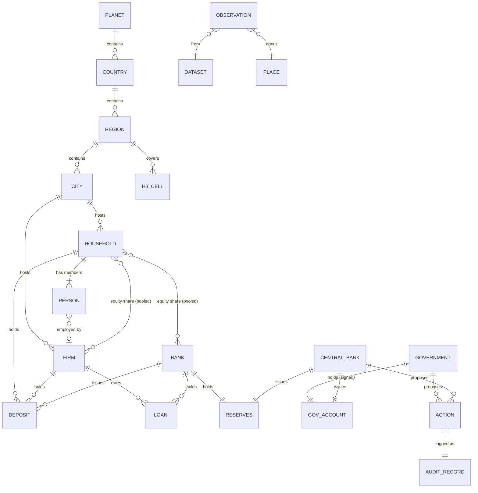

# 04 · World Entity Ontology and Entity-Relationship Model (Task 4)

## 1. Principles

* Every entity has a **stable id**, a **type**, a **location** (geo id and/or H3 cell), a **time
  validity**, and **provenance** for its attributes.
* **Stocks vs flows:** stocks (population, deposits, inventories, carbon in atmosphere) live in
  state; flows (births, payments, emissions) are recorded per tick and must reconcile stocks.
* **Financial instruments** are relations between two balance sheets (holder ↔ issuer), never
  attributes of one agent.
* **Synthetic vs real:** a `synthetic` flag on places and populations; real places come only from
  catalogued boundary data.

## 2. Top-level classes

| Domain | Entities (✅ = in Alpha) |
|---|---|
| Geography | Planet ✅, Continent, Country ✅, Region ✅, District, City ✅, Neighbourhood, Cell (H3) ✅, Location/Asset |
| Physical Earth | TerrainCell, River, Lake, Aquifer, OceanBasin, AtmosphereColumn, SoilUnit, ForestPatch, MineralDeposit, HazardEvent |
| Population | Person ✅, Household ✅, Family relation (implicit via household) ◐, Cohort (aggregate) ✅ |
| Economy | Firm ✅, Bank ✅, CentralBank ✅, Government ✅, Market (labour ✅, goods ✅, credit ✅), Product/Sector, Contract (employment ✅ implicit, loan ✅ aggregated per firm) |
| Institutions | Ministry/Agency, LegalRule, Treaty, InternationalOrganisation |
| Infrastructure | Road/Rail/Port/Airport segment, PowerPlant, GridLine, WaterNetwork, Hospital, School |
| Environment | ClimateState, WaterBalance, CropSystem, EnergySystem, Ecosystem/Habitat |
| Knowledge | Technology, Innovation, Dataset ✅ (catalogue), Observation ✅ |
| Simulation meta | World ✅, Run, Scenario ✅, Intervention ✅, Action ✅, AuditRecord ✅ |

## 3. Entity-relationship model (Alpha subset, extensible)

## 4. Attribute schemas (Alpha, as implemented)

**Person** (`population/tables.py`): `pid, hh, age_m, sex, edu, status, employer, alive, weight, birth_tick`.
Status ∈ {child, student, employed, unemployed, inactive, retired}.

**Household**: `hid, region, city, alive, weight, deposits, loans, equity_share, income_exp, income_cur, income_last, consumption_last, n_members`.

**Firm** (`economy/state.py`): `fid, city, region, alive, price, markup, productivity, wage_offer,
inventory, exp_demand, target_output, labour_demand, unfilled, fired, deposits, loans, loan_rate,
output/sales/wage-bill/interest/profit flows, distressed, dead_months, age_m`.

**Bank** `reserves, equity` · **Government** `balance, tax and transfer instruments` · **CentralBank** `policy_rate`.

**Place** (`geo/hierarchy.py`): `id, level, name, parent, centroid, cells, resolution, synthetic, attributes`.

## 5. Planned extensions to the ontology (with the engine that needs them)

| Extension | Needed by | Phase |
|---|---|---|
| Partnership & kinship links (Person–Person) | family formation, inheritance, care | 2 |
| Sector/Product dimension on Firm, input-output coefficients | multi-sector economy, trade | 2 |
| Capital goods, Dwelling (housing stock), Mortgage | investment, housing market | 2 |
| Country ↔ Country relations (trade, treaties, FX) | international engine | 4 |
| Cell-level physical state (land cover, soil, water, temperature) | environment engines | 3 |
| Asset-level infrastructure graph | transport, energy grid | 3–4 |

## 6. Acceptance criteria

* Every Alpha table has an explicit schema and an invariant covering its cross-references (✅
  `population_consistency`).
* ER diagram matches implemented relations (✅ for Alpha subset).
